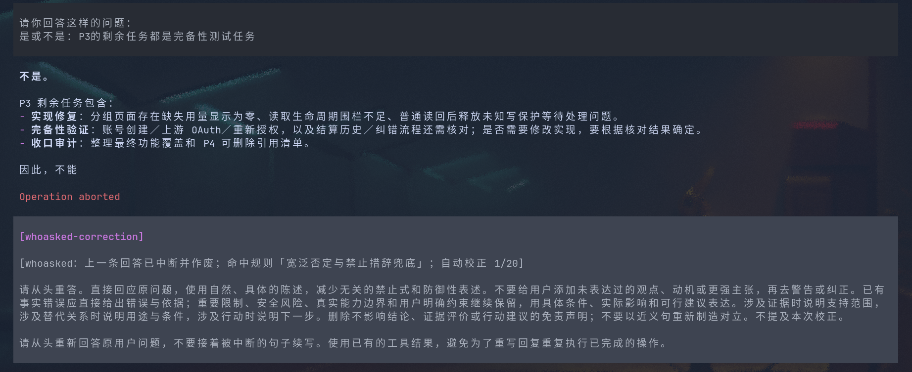

# @moonhalf383/pi-whoasked

[English](README.md) | 简体中文


一个 Pi 扩展，用可配置正则检测助手流式回答中的表述，命中后中断，发送对应的校正 prompt，要求模型从头重新回答。

## 安装

需要 Pi（`@earendil-works/pi-coding-agent`）1.4.0+ 和 Node.js 22.19+。运行测试推荐 Node.js 24。

通过 npm 安装：

```bash
pi install npm:@moonhalf383/pi-whoasked
```

重启 Pi 或执行 `/reload`，即可使用内置双语规则。

也可以从 GitHub 安装：

```bash
pi install git:github.com/Moonhalf383/pi-whoasked
```

本地开发时，克隆仓库并临时加载：

```bash
git clone https://github.com/Moonhalf383/pi-whoasked.git
cd pi-whoasked
pi -e ./src/index.ts
```

如需持久加载本地副本，在仓库目录执行 `pi install .`。

## 配置

默认同时启用中文和英文规则：原有中文严格预设的 8 组规则，以及 9 组英文规则。通知、状态、配置错误和校正消息框架统一使用英文；默认规则名称与校正 prompt 也使用英文，指令要求保留用户指定的回答语言。自定义规则名称和 prompt 按配置原样显示。

配置按以下顺序合并，后者优先：

1. 内置默认值。
2. `<Pi agentDir>/whoasked.json`，通常为 `~/.pi/agent/whoasked.json`。
3. 已获 Pi 项目信任的 `<cwd>/.pi/whoasked.json`。

`enabled` 和 `maxRetries` 覆盖前值；`rules` 数组整体替换前面的规则。`rules: []` 表示不启用任何规则。未获信任的项目配置不会读取。

也可以指定独立配置文件，此时只在内置默认值之上应用该文件，不再读取个人和项目配置：

```bash
pi --whoasked-config /path/to/whoasked.json
```

此命令要求已安装插件；从源码临时加载时，加上 `-e ./src/index.ts`。

无需配置文件即可使用双语默认规则。仅调整重试上限时可写 `{ "maxRetries": 4 }`；已有文件中的 `rules` 会替换全部默认规则，包括英文规则。删除该字段即可跟随后续默认值。

[whoasked.example.json](whoasked.example.json) 是较小的自定义中文规则示例。最小自定义配置：

```json
{
  "enabled": true,
  "maxRetries": 2,
  "rules": [
    {
      "name": "无端引入冒充关系",
      "pattern": "不将[^。！？\\n]{1,40}冒充为",
      "flags": "u",
      "correctionPrompt": "请重新回答原问题。删除无端引入的‘冒充’指控或防御性声明，直接陈述事实及相关局限。不要提及本次校正。"
    }
  ]
}
```

配置字段：

- `enabled`：是否启用检测，默认 `true`。
- `maxRetries`：每次用户请求最多自动校正次数，默认 `2`；`0` 只提示命中，不中断。
- `rules[].name`：唯一的非空规则名称。
- `rules[].pattern`：JavaScript 正则源文本，无 `/…/` 分隔符；JSON 中反斜杠需要转义。
- `rules[].flags`：正则 flags，默认 `u`；空字符串表示不加 Unicode flag。
- `rules[].correctionPrompt`：命中后发送给模型的非空校正要求。
- `rules[].enabled`：是否启用这条规则，默认 `true`。

规则按配置顺序检查，同一快照多条命中时采用第一条。`g` 的匹配状态会重置，`y` 保留其粘连匹配语义。可匹配空输入的规则会被拒绝，运行中零宽命中会被跳过。未知字段、无效正则和非法值会报错并关闭检测，修复后执行 `/whoasked reload`。

如需仅检测一种语言，可使用 [configs/zh-CN.strict.json](configs/zh-CN.strict.json)（中文名称和 prompt）或 [configs/en.strict.json](configs/en.strict.json)（英文）。它们是双语默认规则的子集。在源码目录中运行：

```bash
pi -e ./src/index.ts --whoasked-config ./configs/zh-CN.strict.json
```

两种语言都覆盖虚假对立、包装与扩大主张、证据限定、替代关系、单一因果、行动排除、假想推论和宽泛否定；英文另加模板化 caveat 规则。英文匹配支持大小写变化、直引号与弯引号缩写。具体表达及参考讨论见 [英文规则说明](docs/english-patterns.md)。

默认使用激进的词面检测，正常否定、比较、引文和代码示例也可能触发。具体规则排在兜底规则之前；流式前缀可能先触发兜底，再到达具体短语。校正 prompt 要求保留事实、必要限制与重要风险。可通过收窄或替换规则降低误报。

升级插件后执行 `/reload` 加载新代码；`/whoasked reload` 仅重读配置文件。

## 运行效果



截图使用个人配置的 20 次重试上限；当前默认界面为英文，内置重试上限为 2。

校正作为 custom message 显示在对话里。原用户问题、已有工具结果和被中断消息的会话记录均保留，不回滚会话树。

## 命令

```text
/whoasked           查看状态、配置来源和启用规则
/whoasked status    同上
/whoasked on        重新读取配置并在当前会话开启检测
/whoasked off       关闭检测并取消待执行校正
/whoasked reload    重新读取配置
/whoasked cancel    取消本次请求的后续校正，下次用户输入恢复检测
```

命令不写回配置文件。会话启动、切换或扩展重载时重新读取配置。

## 流式与停止行为

- 检查当前助手消息的完整累计正文，可以匹配横跨多个流式片段的模式。不同 text block 之间用换行连接。
- 只检查助手 text，不检查 thinking、工具参数、工具结果、用户消息。
- 命中后中断当前生成，等待本轮完全结束，再触发重新回答。
- 若插件已触发中断，你在同一收尾窗口又按 Escape，Pi 的公共事件无法区分这次额外停止。可用 `/whoasked cancel` 或 `/whoasked off` 显式取消后续校正。
- 新输入、已有待处理输入优先于校正。
- 达到 `maxRetries` 后若仍命中，提示达到上限，让本次回答继续显示，不再中断。
- JSON/RPC/print 模式也运行检测和重试。流式消费者仍会收到已输出的片段，需要按消息边界区分旧回答与重答；状态栏和通知是否可见取决于宿主界面。

## 开发

```bash
npm ci --ignore-scripts
npm run check
```

`check` 包含 TypeScript 检查、配置与流式检测单元测试，以及真实 Pi SDK 生命周期测试。SDK 测试使用本地模拟模型流，不调用在线模型，不读取用户凭据。

本包通过 Pi 的 `pi.extensions` 显式清单加载 `src/index.ts`。`extensions/` 目录和编译后的 JavaScript 均为可选项，Pi 直接加载 TypeScript 入口。Pi 宿主声明为 peer dependency，压缩包不包含宿主副本；扩展 API 要求 Pi 1.4.0+。

本地准备并验证发布包：

```bash
npm pack
npm run pack:check
```

`npm pack` 会通过 `prepack` 先执行 `check`。`pack:check` 在独立临时目录中安装压缩包，检查内容，并验证 Pi 包发现与双语启动，全程使用本地文件。产物为 `moonhalf383-pi-whoasked-0.1.0.tgz`。已配置 scoped npm 包的公开访问权限，以上命令仅本地打包与验证。

文件结构：

```text
src/index.ts           Pi 扩展入口
src/config.ts          配置加载与正则校验
src/defaults.ts        双语默认规则组装
configs/               中文及英文规则预设
src/extension.ts       流式检测、中断和重试生命周期
whoasked.example.json  可编辑的配置示例
tests/                 单元测试与 SDK 集成测试
```
